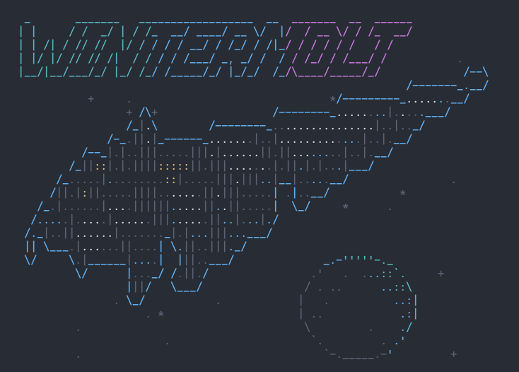

# Wintermolt / Straylight

The startup banner: WINTERMOLT in front of Villa Straylight, the Tessier-Ashpool
spindle, with its planet.

- `villa-straylight.png`: the source image, AI-generated for this project.
- `generate_banner.py`: turns it into the art in `src/banner/`, which
  `src/banner.zig` embeds.
- `straylight-preview.png`: the result, painted in One Half Dark.

## What the generator makes

| File | Size | Shown when |
|---|---|---|
| `src/banner/straylight.*` | 75 x 26 | the window has room for it |
| `src/banner/wordmark.*` | 63 x 5 | it does not; also piped output and `NO_COLOR` |

`banner.zig` adds a one-line `WINTERMOLT` for windows too narrow for the
wordmark.

Each `.txt` has a `.roles` twin of the same shape. A role names the theme slot
that colors the character above it: `A` accent, `P` primary, `S` secondary,
`F` foreground, `M` muted, `W` warning, a space for a space. The plain REPL maps
roles to the terminal's 16 colors; the full-screen view maps them to the active
theme. Either way the banner follows the user's palette instead of carrying
one of its own. Pure ASCII, so a byte is a column.

## How the image becomes ASCII

The hull is low-contrast tile texture, which straight brightness-to-character
conversion turns into speckle. So the ship is handled as a shape:

1. A heavy blur and a threshold give one solid mask; holes are filled, and
   specks and one-cell slivers are dropped.
2. The mask's edge is drawn with `/ \ | _ -`, the interior filled with `.`.
   Amber windows become `:`, darker ring seams `|`.
3. The planet is a hand-drawn round outline placed on a circle fitted to the
   crescent in the image. Lighting from behind, up and to the right, picks
   each character's role: the crescent is lit, the rest is the dark side.
4. WINTERMOLT is pyfiglet's `slant` font, shaded accent to primary to
   secondary, with a one-cell clear border so it sits in front of the art.

## Regenerating

From the repo root (Pillow and pyfiglet are needed only here, never at build
time):

    uv run --with pillow --with pyfiglet python -I docs/ANSI_art/wintermolt/generate_banner.py

The output is deterministic. `zig build test` checks that every `.roles` file
still lines up with its `.txt`.
